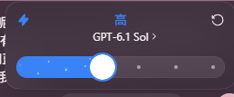

# Codex 海贼王主题优化需求

记录于 2026 年 11 月 9 日。计划 2026 年 11 月 10 日开始设计和实现。本次仅记录需求。

## 1. 启动动画改成草帽团航海旅程

- 开场是一片蓝白色的大海。梅丽号从画面左侧驶入，沿海面向右航行。
- 船驶到画面中段时，梅丽号逐渐过渡为千阳号。切换与剧情中的换船节点对齐，过渡之后由千阳号继续向右航行。
- 船保持航行，背景逐段切换为草帽团沿途经历的代表场景。场景必须严格按草帽团实际旅程的先后排列，换船前后的经历也要归到对应船只的航段。
- 海上航行部分以海蓝和浪白为主，沿途场景保留自身辨识特征，整体看起来像同一段航行。
- 制作前先核对篇章和换船节点，列出「顺序 / 篇章或地点 / 代表画面 / 船只 / 转场」分镜表。采用原作主线或动画口径、覆盖到哪个篇章、完整播放时长，留到开工时确认。

**验收**。能看出船从左向右航行、梅丽号在中段逐步变为千阳号，且每段背景顺序都能与分镜表逐项对照。沿用当前预览的重播、Esc 跳过与减少动态效果。

## 2. 推理强度切换联动路飞形态

切换 Codex 的模型推理强度时，在截图上方蓝色「高」所在的档位区域，显示对应的路飞形态。候选形态包括常态、二档、三档、四档和五档。具体档位映射、形态的呈现方式，以及是否同时保留档位文字，待后续确认。

**验收**。切换强度后，形态与当前选中的真实档位一致。更换模型时，按该模型实际可用的档位更新展示。

## 3. 同主题 Codex 桌宠

需要设计与这套海贼王主题呼应的 Codex 桌宠。等 11 月 10 日收到用户补充后，再确定角色、形态、画风和动作。

## 续做顺序

1. 核对草帽团旅程及两艘船的切换节点，先做按时间顺序排列的启动分镜。
2. 基于分镜实现蓝白海面、船只航行、船型过渡与背景切换，并在现有预览里验证。
3. 检查截图所示推理强度控件的实际状态，确认档位与形态的对应关系后接入。
4. 收到桌宠补充后另做桌宠设计。沿用项目现有的 GitHub 打包规则，将海贼王主题素材与公开发行包分开。

## 2026 年 11 月 10 日续做决定

- 采用原作主线，从西罗布村获得梅丽号开始，取景至艾尔巴夫。换船节点和路飞支线的处理见 [航海启动分镜](航海启动分镜.md)。
- 首版档位映射为低档常态、中档二档、高档三档、更高档四档、最高档五档，保留真实强度文字。原生入口由可选 Dream Skin 启动路径接入。
- 桌宠默认为 2D 常态路飞。已确定吃肉、睡觉、走路，点击角色可在常态和进阶形态之间切换。实现另加待机、挥手和跳跃，桌宠形态独立于推理档位。
